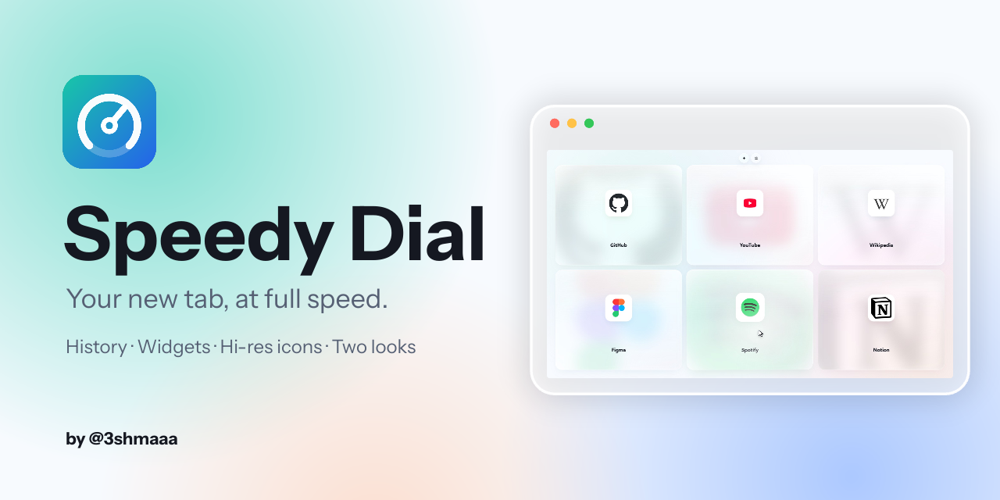
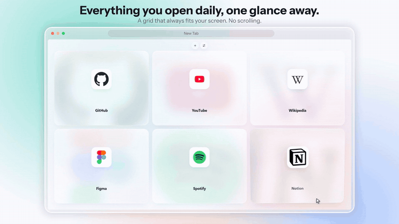
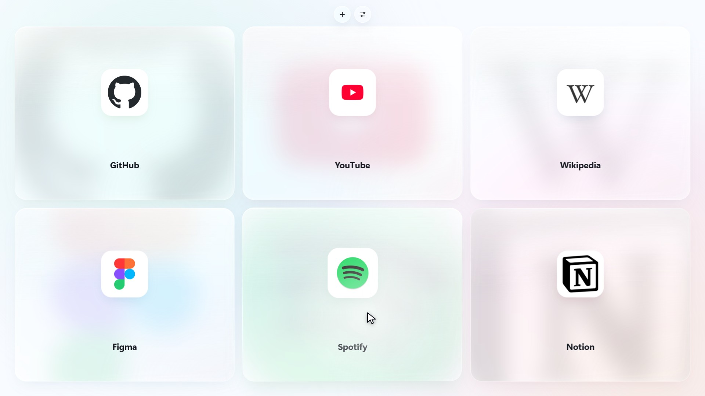
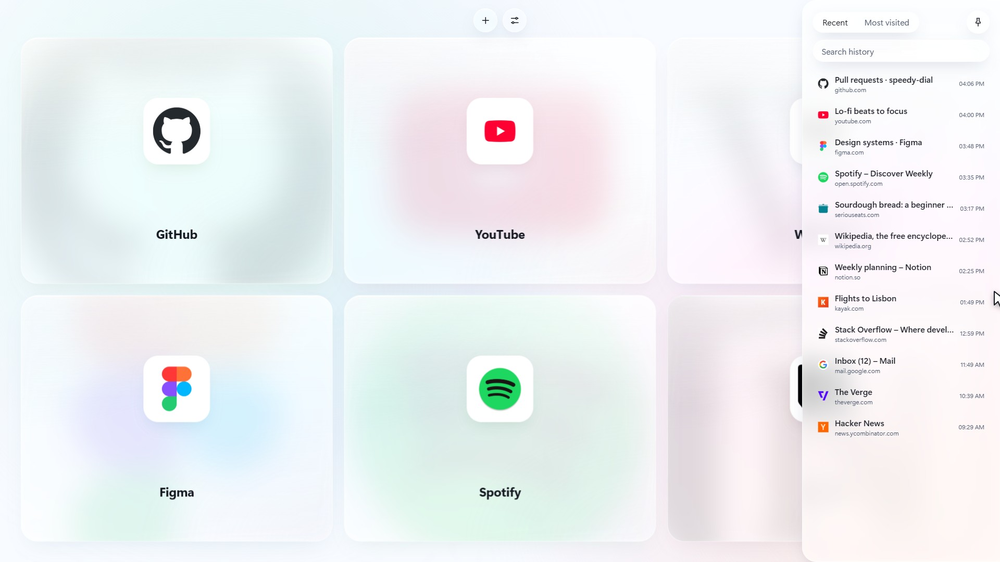
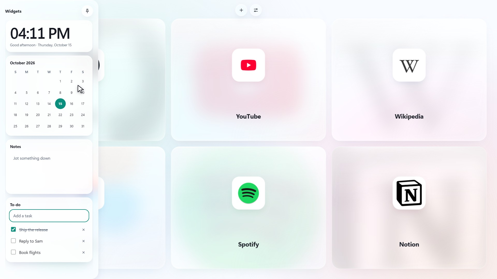
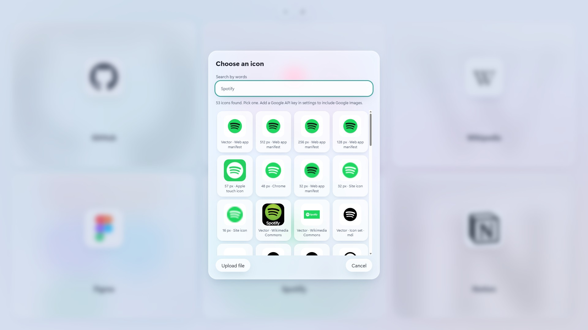
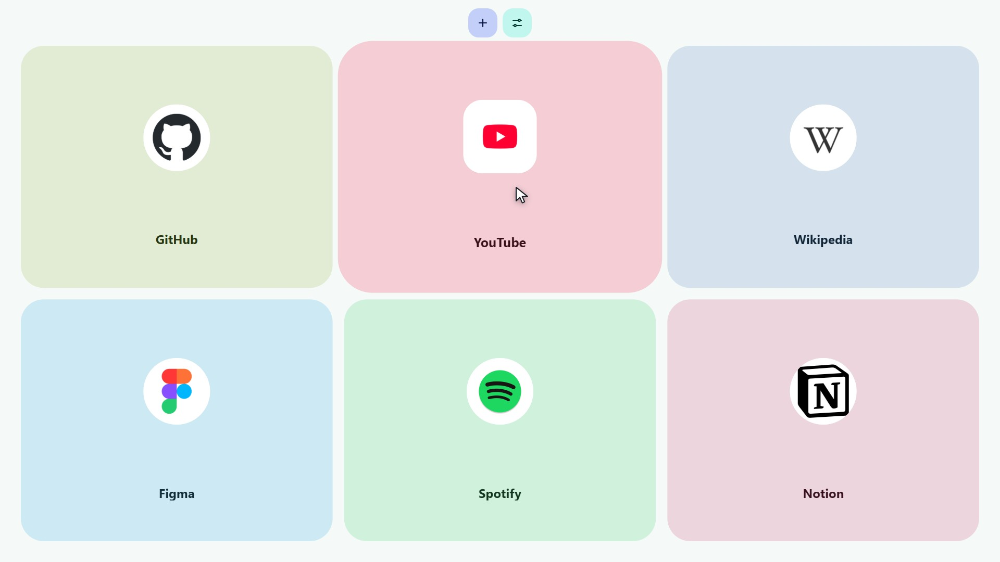
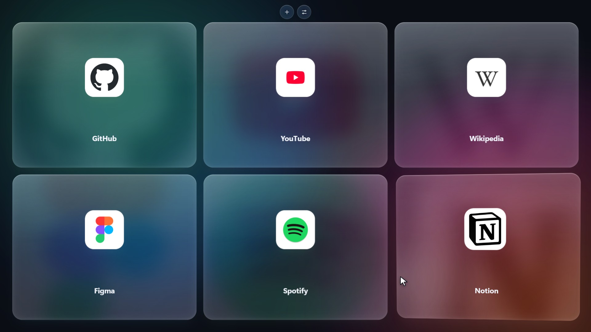
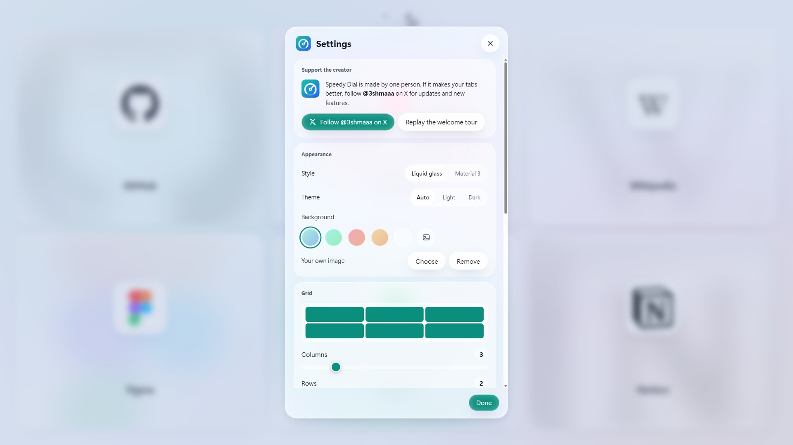
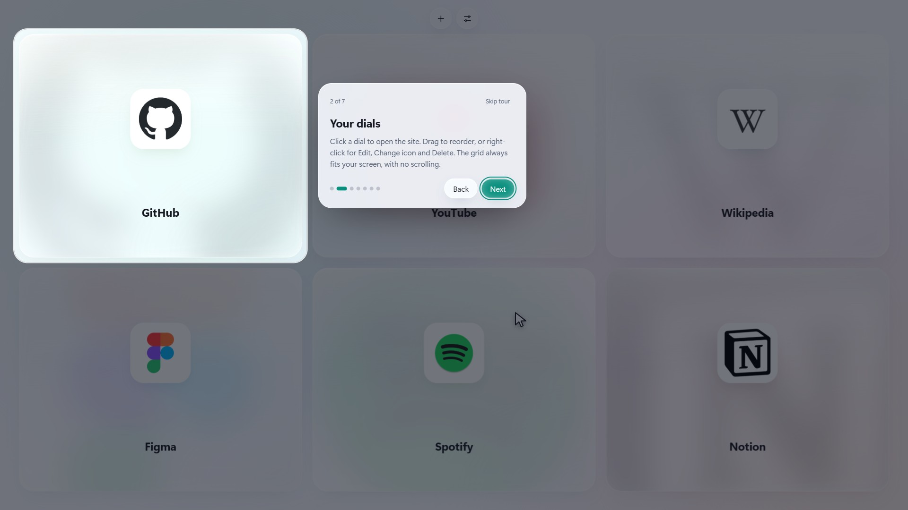

  

  

  <b>A fast, good-looking new tab for Chrome, Edge, Brave and other Chromium browsers.</b> 
  Your sites in a grid that always fits the screen, a history sidebar that slides in when you touch the edge,
  optional widgets, sharp icons found for you, and two looks you can switch between live.

  <a href="../../releases/latest">Download</a> ·
  <a href="#install">Install</a> ·
  <a href="../../releases/latest/download/speedy-dial-launch.mp4">Watch the launch video</a> ·
  <a href="#privacy-and-permissions">Privacy</a>

  
   
  Click the preview to watch the full 50-second launch video.

---

## What you get

**A grid that always fits.** Three columns by two rows by default, up to eight by six, and it never scrolls. Each dial is a card tinted with its site's own color. Drag to reorder, right-click for Edit, Change icon, Refresh icon and Delete. Turn on **Square dials** and the cards stay square and spread to fill the screen.

**History, one hover away.** Move the pointer to the right edge and your history slides in, with Recent and Most visited tabs and a search box. Pin it to keep it open. It also works from the keyboard: Tab to the edge and press Enter.

**Widgets, only if you want them.** A clock, a calendar, notes and a to-do list live in a sidebar on the left edge. They are all off until you switch them on in Settings.

**Icons that stay sharp.** Speedy Dial reads a site's own icon links, its web app manifest and its Apple touch icons, picks the largest one, and saves it as a 512 px rounded square. Small icons are enlarged in steps and sharpened. If you don't like the result, **Find icon** searches by name across icon sets and Wikimedia Commons (and Google Images, if you add your own key), or you can upload a file.

**Two looks.** *Liquid glass* is frosted, light and airy. *Material 3 Expressive* has solid tonal surfaces, bigger shapes that morph as you hover, and springy motion, with its whole palette built from one accent color you choose. Both follow your system's light or dark theme, or you can force one. Pick a pastel background or your own photo.

**Add a site in one click.** Use the toolbar button, press `Alt+Shift+D`, or right-click any page or link and choose *Add to Speedy Dial*.

**A short welcome tour.** On a fresh install, a seven-step tour walks through all of this, and you can replay it any time from Settings.

<table>
  <tr>
    <td width="50%"> <b>The dial grid</b>, with the hover tilt and icon lift.</td>
    <td width="50%"> <b>History</b> slides in from the right edge.</td>
  </tr>
  <tr>
    <td width="50%"> <b>Widgets</b>: clock, calendar, notes and to-do.</td>
    <td width="50%"> <b>Find icon</b>: pick the icon you like best.</td>
  </tr>
  <tr>
    <td width="50%"> <b>Material 3 Expressive</b>, tinted by each site's color.</td>
    <td width="50%"> <b>Dark theme</b> with Liquid glass.</td>
  </tr>
  <tr>
    <td width="50%"> <b>Settings</b>: style, theme, grid size, widgets, backup.</td>
    <td width="50%"> <b>The welcome tour</b> spotlights the real interface.</td>
  </tr>
</table>

The sites in the screenshots and the video are examples. Their names and logos belong to their owners.

## Install

Speedy Dial is not on the Chrome Web Store yet, so you load it as an unpacked extension. It takes about a minute and works the same in every Chromium browser.

### From a release (easiest)

1. Download **`speedy-dial-v1.4.0.zip`** from the [latest release](../../releases/latest).
2. Unzip it to a folder you will keep. Chrome reads the extension from that folder, so don't delete or move it afterwards.
3. Open the extensions page: `chrome://extensions` in Chrome, `edge://extensions` in Edge, `brave://extensions` in Brave.
4. Turn on **Developer mode** (the switch in the top right).
5. Click **Load unpacked** and choose the unzipped folder, the one that contains `manifest.json`.
6. Open a new tab. The welcome tour starts.

### From the source code

Click **Code → Download ZIP** on this page and unzip it, or clone the repository. Then follow steps 3 to 6 above and choose the **`speed-dial`** folder inside it.

### Good to know

- **Pin it.** Click the puzzle-piece icon in the toolbar and pin Speedy Dial so the add-a-site button stays within reach.
- **Developer mode warning.** Chrome may remind you at startup that you are running an extension in developer mode. That is normal for unpacked extensions; you can dismiss it.
- **Updating.** Replace the files in your folder with the new version, then press the reload arrow on Speedy Dial's card in the extensions page. Your dials and settings are kept.
- **Keep the folder where it is.** Chrome ties an unpacked extension's saved data to its folder path. If you load it from a different folder, it counts as a new extension and starts empty. Use Settings → Export before you move it, and Import afterwards.
- **Uninstalling.** Click **Remove** on its card in the extensions page. This also deletes its saved data.
- **Browsers.** It needs a Chromium browser with Manifest V3 support (Chrome 120 or newer is a safe bet). Firefox and Safari are not supported.

## Using it

| To do this | Do this |
| --- | --- |
| Add the page you are on | Click the toolbar button, press `Alt+Shift+D`, or right-click and choose *Add to Speedy Dial* |
| Add any site by address | The **+** button at the top of the new tab |
| Edit, change the icon, or delete a dial | Right-click it |
| Reorder dials | Drag one onto another |
| Open history | Move to the right edge (or Tab to it and press Enter). Click the pin to keep it open |
| Open widgets | Turn them on in Settings, then move to the left edge |
| Change the grid size | Settings → Grid. It grows by itself when it fills up |
| Switch look, theme or background | Settings → Appearance |
| Back up or move your dials | Settings → Export and Import |
| Watch the welcome tour again | Settings → Support the creator → Replay the welcome tour |

## Privacy and permissions

Speedy Dial has no account, no analytics, no ads and no server of its own. Your dials, settings, notes and to-dos are stored on your device with Chrome's extension storage and are not synced anywhere. Your browsing history is only read to fill the history sidebar and never leaves your computer.

The one thing that touches the network is icon finding. When you add a site, refresh an icon, or open **Find icon**, the extension requests:

- the site's own home page, its web app manifest and its icon files, directly from that site;
- if the site's icons are missing or tiny, Google's icon service (`t2.gstatic.com`, `www.google.com/s2/favicons`) and `icon.horse`, which receive the site's domain;
- when you search by name in Find icon, [Iconify](https://iconify.design) (`api.iconify.design`) and Wikimedia Commons, which receive your search words;
- Google's Programmable Search API, only if you add your own API key and search engine ID in Settings. The key stays on your device.

| Permission | Why it is needed |
| --- | --- |
| `storage`, `unlimitedStorage` | Saving your dials, settings and the high-resolution icons you cache locally |
| `history` | Showing your history in the sidebar (read only) |
| `topSites` | Filling your first dials from the sites you visit most, once, on a fresh install |
| `favicon` | Using Chrome's own icon cache as a fallback |
| `contextMenus` | The right-click *Add to Speedy Dial* entry |
| Access to all sites (`<all_urls>`) | Downloading other sites' icon files from the new tab page. Speedy Dial has no content scripts and never reads the pages you browse |

## How it is built

Plain JavaScript, HTML and CSS under Manifest V3, with no framework, no dependencies and no build step. You can read all of it in an evening.

| File | What it does |
| --- | --- |
| `speed-dial/manifest.json` | The extension manifest |
| `speed-dial/newtab.html` | The new tab page and all dialogs |
| `speed-dial/app.js` | The grid, dials, icon finding, history and settings |
| `speed-dial/extras.js` | Theme, background, widgets, context menu, drag animation |
| `speed-dial/onboarding.js` | The first-run welcome tour |
| `speed-dial/background.js` | The toolbar button, keyboard shortcut and context menu |
| `speed-dial/style.css`, `m3.css` | Liquid glass, and Material 3 Expressive |

Also in this repository: `docs/` holds the images used here, `branding/` the logo, `tools/` the scripts that draw the icon and the banner, and `launch-video/` the source of the launch video, including the screen-recording harness that runs the real extension in a browser tab. The finished video is a [release download](../../releases/latest/download/speedy-dial-launch.mp4).

## Support the creator

Speedy Dial is made by one person. If it makes your tabs better, following on X is the best way to say thanks and to hear about new features first.

  

Bug reports and ideas are welcome in the [issues](../../issues).

## License

Copyright © 2026 3shmaaa. All rights reserved. You may read the code and install the extension for your own use. Any other use needs written permission, which you can ask for on [X](https://x.com/3shmaaa). See [LICENSE](LICENSE).
